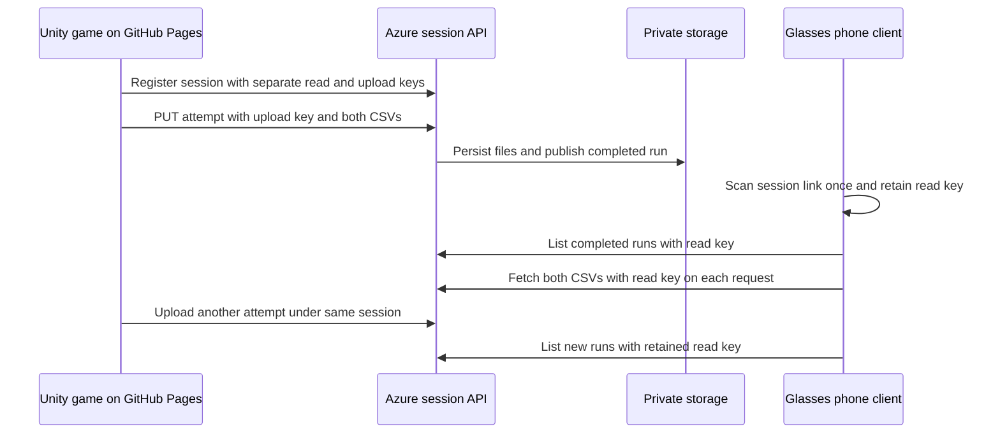

# Rhythm session adapter contract

Prepared 2026-11-14 for the backend, Unity rhythm engine, and phone client developers.

One QR scan gives the phone read access to both CSVs for every completed attempt in the same game session. The game sends its data to the Azure backend; the phone discovers attempts through an authenticated listing. GitHub Pages continues to host the game.

**Status:** [docs] The session identity, QR shape, folder model, and CSV formats below follow the Owner's current instructions and the inspected engine source. **[assumed] All API routes, payload additions, limits, and lifecycle defaults in this document are a proposed implementation contract. They are not confirmed deployed endpoints.** Read-only requests to the supplied service and its `/openapi.json`, `/docs`, and `/health` could not establish an API contract from this environment. This is not evidence that the service is down.

```text
SUGGESTION  from: Lead / Coordinator  area: tech
idea: Use a session API with separate read and upload capabilities and one atomic upload per attempt.
why: One scan can retrieve every completed song while preventing read access from granting writes.
cost: Backend session routes, private storage, Unity upload queue, and phone session fetcher.
alternatives: Adapt existing backend routes to these semantics; use staged file uploads plus an explicit commit.
status: PROPOSAL (needs Owner approval)
```

Developer instructions: [backend developer](20-backend-adapter-instructions.md) and [rhythm engine developer](21-rhythm-engine-adapter-instructions.md). This is the shared reference for their request and response shapes. Exact routes can be mapped onto an existing backend, but both developers must use the same mapping.

## Addresses and responsibilities

```text
API_BASE = https://YOUR-APP.azurewebsites.net
PUBLIC_CLIENT_URL = <API_BASE>/sessions
QR = <PUBLIC_CLIENT_URL>/<session_id>/?key=<session_key>
```

`API_BASE` has no trailing slash. `PUBLIC_CLIENT_URL` includes `/sessions` exactly once. The `/sessions/.../` route is a link entry point; API traffic uses `/v1/...`. The QR remains ordinary URL text with the existing query parameter. It contains neither CSVs nor a run ID. Both results-screen QR choices keep the same session URL.



[docs] Current source: `MusicalSpartansRhythmEngine/RhythmGameEngine/Backend/SESSION-CONTRACT.md`, `Runtime/App/GameSession.cs`, `Runtime/Screens/ResultsScreen.cs`, and `Core/{RunResult,CsvWriter,SongSummary,PerSecondAggregator,Scoring}.cs` under `Assets/RhythmEngine/`.

[docs] `BackendRunUploader`, `BackendRunEnvelope`, and `Backend/README.md` describe an earlier per-run design. The old README's static shared-key staging instructions must not be used. Older QR packing sections in `13-data-contract.md` and `14-game-engine-design.md` are superseded for this network transport; their historical binary format is not the HTTP API schema.

## Credentials and session lifecycle

The following mechanics are proposed [assumed]:

- Keep the existing app-generated `session_id` (32 lowercase hexadecimal characters) and `session_key` (24 random bytes encoded as 32 unpadded Base64url characters). Retain both across scenes and retries; restart or WebGL refresh creates new values. Validate the entire ID and key strings, not just a prefix.
- Add an independent `upload_key` with the same randomness and encoding. Generate it once per app session using the same cryptographic RNG, never derive it from the QR key. Keep it only in game memory. It grants upload and revocation access to that session; the QR read key grants neither.
- Registration is anonymous and open to new sessions, subject to quotas and rate limits. There is no shared developer secret in the public WebGL build. This permits anonymous uploads, **not proof that a trusted game produced the data**. CORS is not authentication.
- Store hashes of the two keys, bound to the session and their separate scopes; compare securely. Do not retain plaintext keys in logs or database records. Each request checks the correct key, session state, and expiry.
- Proposed fixed lifetime: 24 hours from first registration. Retries and uploads do not extend it. Deny all access after expiry or revocation; delete CSVs and associated session data within the following 24 hours. Configure storage lifecycle and backup retention consistently. Backend developer and Owner must confirm these values before release.
- Revocation requires the upload key or an authenticated backend operator. The read key cannot revoke. No upload-key recovery through the read key. A client that loses its upload key starts a new session.

Use `Authorization: Bearer <session_key>` on read API requests and `Authorization: Bearer <upload_key>` on write API requests. Never forward either credential across an HTTP redirect or to another host. Do not accept `?key=` on the `/v1` API; it belongs only to the QR entry link.

## Proposed endpoints

All JSON uses UTF-8, snake_case names, and UTC timestamps with a `Z` suffix. Examples contain placeholders, not credentials.

| Method and path | Credential | Success |
| --- | --- | --- |
| `POST /v1/sessions` | New keys in JSON body | `201` created; `200` identical registration retry |
| `PUT /v1/sessions/{session_id}/runs/{run_id}` | Upload bearer | `201` first commit; `200` identical retry |
| `GET /v1/sessions/{session_id}/runs?after_sequence=0&limit=100` | Read bearer | `200` completed runs |
| `GET /v1/sessions/{session_id}/runs/{run_id}/series.csv` | Read bearer | `200 text/csv; charset=utf-8` |
| `GET /v1/sessions/{session_id}/runs/{run_id}/summary.csv` | Read bearer | `200 text/csv; charset=utf-8` |
| `DELETE /v1/sessions/{session_id}` | Upload bearer | `204` revoked |
| `GET /sessions/{session_id}/?key=...` | QR entry link | Minimal landing route, no CSV response |

### Register once per game session

```http
POST /v1/sessions
Content-Type: application/json

{
  "contract_version": 1,
  "session_id": "<32-hex-session-id>",
  "session_key": "<32-character-read-key>",
  "upload_key": "<32-character-independent-upload-key>"
}
```

```json
{
  "contract_version": 1,
  "session_id": "<32-hex-session-id>",
  "created_at": "2026-11-15T04:00:00Z",
  "expires_at": "2026-11-16T04:00:00Z"
}
```

The game constructs the QR locally from the configured root and its retained values. The response must not echo keys or a full QR URL. Replaying registration with the same ID and **both** matching keys returns the original timestamps. Any credential mismatch returns `409 session_conflict`, changes nothing, and does not disclose existing credentials. Expired or revoked sessions cannot be recreated by replaying registration. Retain minimal session tombstones through the cleanup interval; afterwards the old capability still cannot read deleted data.

Because both keys are client-generated and retained, a lost registration response is recoverable by retrying the same request. No token issuance or write recovery using the read key is required.

### Upload one attempt with both CSVs

```http
PUT /v1/sessions/<session_id>/runs/<run_id>
Authorization: Bearer <upload_key>
Content-Type: application/json
```

```json
{
  "contract_version": 1,
  "finished_at_utc": "2026-11-15T04:03:42Z",
  "game_id": 2,
  "song_id": 103,
  "chart_id": 1,
  "sample_interval_sec": 1,
  "autoplay": false,
  "latency_basis": "successful_hits_only_v1",
  "successful_hit_count": 1,
  "summary_exceeds_format_range": false,
  "series_csv": "game_id,2\nsong_id,103\nchart_id,1\nbpm,120\nsample_interval_sec,1\ngame_time,percent_accuracy,avg_latency,bpm,nps,latency_spread\n0,,,120,0,\n1,100,-12,120,1,\n",
  "summary_csv": "02,103,3,2000,120,1,1000000,-12"
}
```

This short example has one successful hit and therefore no spread value. The JSON strings contain the complete CSVs in actual requests. `contract_version` versions this HTTP envelope, independently of `ContractPacker.FormatVersion`.

`run_id` is the existing engine-generated 32-hex attempt ID. Keep it and the entire payload unchanged on every retry. A replay of a song creates a new `run_id`. Do not identify an attempt by `song_id` or `chart_id`.

```json
{
  "session_id": "<session_id>",
  "run_id": "<run_id>",
  "sequence": 1,
  "status": "completed",
  "completed_at": "2026-11-15T04:03:44Z"
}
```

The server assigns a strictly increasing `sequence` within the session at publication. `completed_at` is the first server commit time, immutable on retries. `finished_at_utc` is the game-reported completion time, useful for display but not a trusted ordering cursor.

Store immutable file contents and metadata before atomically publishing the completed record. With blob storage, stage both private objects first, then transactionally insert the completed manifest row; a failed upload exposes neither file via the API. Listing and file reads require a completed manifest record. Clean abandoned staged objects. Recheck session validity at publication so revocation racing an upload cannot publish it afterwards.

For `(session_id, run_id)`, identical parsed metadata and exact UTF-8 CSV contents return the original record. A changed field or CSV returns `409 run_conflict`; never overwrite a committed run. Compute a digest over an explicitly ordered, length-delimited representation of those fields and bytes, not raw JSON serialization order. Enforce uniqueness transactionally, including simultaneous retries. Concurrent losing requests must not delete objects belonging to the winning commit.

### List and retrieve completed attempts

```json
{
  "session_id": "<session_id>",
  "expires_at": "2026-11-16T04:00:00Z",
  "runs": [
    {
      "run_id": "<run_id>",
      "sequence": 1,
      "status": "completed",
      "completed_at": "2026-11-15T04:03:44Z",
      "finished_at_utc": "2026-11-15T04:03:42Z",
      "game_id": 2,
      "song_id": 103,
      "chart_id": 1,
      "sample_interval_sec": 1,
      "autoplay": false,
      "latency_basis": "successful_hits_only_v1",
      "successful_hit_count": 1,
      "summary_exceeds_format_range": false,
      "files": {
        "series": "/v1/sessions/<session_id>/runs/<run_id>/series.csv",
        "summary": "/v1/sessions/<session_id>/runs/<run_id>/summary.csv"
      }
    }
  ],
  "next_after_sequence": 1,
  "has_more": false
}
```

Return only committed attempts with `sequence > after_sequence`, ordered ascending. Default and maximum page size are 100. Set `next_after_sequence` to the last returned sequence, or the supplied cursor for an empty result. `has_more` means more committed runs exist beyond this page at query time. Empty sessions return `200` and `runs: []`. Later uploads can appear in subsequent requests even after `has_more` was false.

The file paths are API-relative, contain no credentials, and resolve only to this HTTPS API origin and the listed session/run. Never return public blobs or signed blob URLs that bypass per-request session checks. Store objects privately as `<session_id>/<run_id>/series.csv` and `summary.csv`, or equivalent private database content. Downloads must recheck revocation and expiry even when the phone obtained their paths earlier.

## CSV interpretation and validation

[docs] Preserve the engine CSV bytes; do not convert the series into an ordinary header-first CSV or add a header to the summary.

| Input | Meaning and adapter requirement |
| --- | --- |
| Series metadata | Five rows: `game_id`, `song_id`, `chart_id`, `bpm`, `sample_interval_sec`; table header is row six. |
| Series columns | Exactly `game_time,percent_accuracy,avg_latency,bpm,nps,latency_spread`. |
| `game_time` | Window start in seconds; rows are grouped by scheduled note time. Require increasing starts on the declared interval, starting at zero. |
| `sample_interval_sec` | Current engine emits 1 or 2. Read the value; reject unsupported intervals explicitly. |
| `nps` | Current CSV stores chart note count in the window, holds counted once at their head. Derived density is `nps / sample_interval_sec`, including two-second windows. Preserve raw counts. |
| Empty cells | Unavailable, not zero. An actual numeric zero remains a valid measurement. |
| Timing | Signed milliseconds; negative means early. Spread is population standard deviation in ms, empty with fewer than two successful hits. |
| Summary | Exactly one record, no header: `game_id,song_id,difficulty_band,game_time_ms,bpm,total_notes,score,avg_latency_ms`. Accept an optional final newline. |
| IDs | Parse decimal IDs so `02` and `2` agree. `chart_id` is not the difficulty band. Keep session, attempt, song, and chart IDs distinct. |
| Difficulty and score | Difficulty 1–4; score 0–1,000,000. Summary duration is raw milliseconds. |
| BPM | Series can have decimals; summary rounds nominal BPM to an integer. Do not require exact textual equality. |

Proposed validation [assumed]: reject invalid numeric values, NaN/infinity, malformed field counts, missing metadata, unsupported envelope versions, negative density/spread, or accuracy outside 0–100. Validate metadata against the envelope and summary; allow the documented BPM rounding. Validate summary format limits from `SongSummary.cs` (IDs 0–99 and 0–999, duration 0–999999 ms, BPM 0–999, notes 0–3000). Do not reject otherwise valid runs merely because a CSV string ends with CRLF instead of LF; preserve the submitted bytes for retries.

[docs] `SongSummary.ToCsv()` can saturate values and reports `ExceedsFormatRange`. Therefore carry `summary_exceeds_format_range` from the engine: if true, preserve both files and the raw envelope identity, allow only mismatches explained by those documented summary clamps, and mark the summary unsuitable for exact coaching claims. Do not silently reinterpret a saturated summary as accurate raw data.

[docs] The current series aggregator includes any non-null `OffsetMs`, including timing misses. `Scoring.Summarize()` excludes `Judgement.Miss`. The engine developer must fix the series filter before labelling an upload `successful_hits_only_v1`. Preserve miss offsets internally for result diagnostics; include misses in accuracy and note counts. Exclude them only from hit latency mean/spread. The backend cannot repair already aggregated CSVs because note-level judgements are absent.

[docs] The existing summary emits average latency `0` when there are no successful hits. The new `successful_hit_count` distinguishes this sentinel case from a genuine zero-ms average. If it is zero, the phone must treat summary latency as unavailable, and series latency/spread must be empty. Do not average per-window means to recreate a whole-song mean: successful-hit counts per window are not in this CSV. Do not invent exact miss counts from rounded accuracy or infer unexported per-note events.

For this envelope, `successful_hit_count` counts results with a non-Miss judgement and a non-null signed offset, matching the timing population. It is a nonnegative integer and cannot exceed the sum of the series window note counts.

## Error and retry behavior

Error bodies use `{"error":{"code":"run_conflict","message":"Attempt already exists with different content"}}`. Never echo keys, request bodies, or full QR URLs.

| Status | Meaning | Client action |
| --- | --- | --- |
| `400` | Malformed JSON, ID, or cursor | Correct request; no automatic retry. |
| `401` | Missing/invalid credential, or unknown session | Stop that request; do not rotate session identity automatically. |
| `403` | Valid credential has wrong scope | Fix adapter; QR read key cannot write. |
| `404` | Authenticated session, missing/unpublished run or fixed filename | Keep existing cursor/data; retry listing later when appropriate. |
| `409` | Registration or run ID conflicts | Surface failure; do not mint another ID to hide it. |
| `410` | Correct credential for expired/revoked session | Stop polling/uploads; require a new game session for new data. |
| `413` | Request too large | Surface failure; retain local export. |
| `422` | Invalid CSV, metadata, or version | Fix producer; no automatic retry. |
| `429` | Rate/quota limit | Retry after `Retry-After` if supplied; quota exhaustion may need operator action. |
| `5xx`, network failure, timeout | Outcome may be unknown | Retry same ID and frozen payload with backoff. |

Proposed limits [assumed]: 256 KiB UTF-8 per CSV, 2 MiB total JSON request, 200 completed attempts per session. Return `429 session_quota_exceeded` for a full session. Use bounded exponential backoff with jitter, for example 1, 2, 4, 8, 16, then at most 30 seconds. Keep pending work across scene changes during the current app lifetime. Browser refresh currently loses the session and pending uploads; persistent recovery would be separate work.

## Deployment and credential handling

- Serve HTTPS only and private storage only. On API JSON and CSV responses, send `Cache-Control: no-store`; on the QR landing route also send `Referrer-Policy: no-referrer`. Apply `X-Content-Type-Options: nosniff` and disable shared caching/CDN caching for authenticated routes. Check authorization before conditional file responses.
- Phone scanning parses the QR locally; it should not open the URL just to extract the key. Validate the scheme, exact host, `/sessions/{id}/` path, and one well-formed `key` parameter before making requests. Store keys in memory for the active session and redact them from diagnostics.
- The browser landing route must not auto-redeem or consume a one-use key. It can show a minimal connection instruction. If it has script, remove the query from the address bar using `history.replaceState` before any other request. Do not include third-party analytics, fonts, images, or outgoing links containing the key.
- Query removal in browser script cannot erase the initial request. Before enabling QR links, configure Azure access logs, reverse proxies, Application Insights, tracing, error reports, and frontend analytics to omit/redact the `key` query value and authorization headers. Disable request-body capture for registration and uploads. Test redaction with a disposable credential. Full URLs are secrets.
- Configure CORS for the exact production GitHub Pages **origin**, not a repository URL path. [assumed] The local `MusicalSpartans.github.io` folder suggests `https://musicalspartans.github.io`; the engine developer must confirm the actual deployed origin. Add specific local development origins only when needed. Allow `GET, POST, PUT, DELETE, OPTIONS` and headers `Authorization, Content-Type, Accept`; expose `Retry-After` if used. Preflight `OPTIONS` needs no bearer token and returns no private data. Use no cookies or credentialed CORS. Native Android requests do not depend on CORS.

## Phone adapter boundary

The two developers must hand this response contract to the phone developer; backend upload alone does not connect coaching.

1. Decode and validate the session URL once; retain `(api_origin, session_id, session_key)` for the active game session.
2. Fetch every listing page from cursor zero on first attachment; retrieve both CSVs for each entry using the read bearer on **each** request. Keep runs keyed by `(session_id, run_id)` and preserve all attempt metadata, including autoplay and data-quality fields.
3. Advance the ingestion cursor only after both files and the record have been successfully parsed and retained. Track `coached_run_ids` separately; a download is not proof that coaching completed. Concurrent fetches must not advance past an unresolved earlier sequence.
4. On later song actions or bounded polling while active, fetch after the retained cursor. Choose the latest eligible uncoached attempt by highest server sequence. Here “latest” means latest backend publication; delayed uploads can have an older `finished_at_utc`. Do not coach autoplay as player performance. Keep earlier ingested runs for the session report.
5. Retain the session when listing is empty or a new upload is pending. Do not ask for another scan for every song. Retry transient failures, stop on expiry/revocation, and avoid duplicate coaching on repeated scans or listings.

No live glasses behavior is asserted by this contract. Simulator or HTTP tests must be reported as [simulated] or [docs], not [verified] hardware evidence.

## Joint acceptance checks

Run with disposable sessions against the deployed HTTPS API and the actual GitHub Pages WebGL build. Record status codes and IDs with credentials redacted.

1. Register a session, lose the response, retry the same keys: original session and expiry return. Different keys with the same ID cannot replace it.
2. Finish song A, upload its two CSVs, and retrieve both through one scan. Play A again: different `run_id`, same session/key. Play B: third run appears without rescanning.
3. Retry a committed PUT, including simultaneous requests: one listing entry and original sequence/time. Change one CSV byte: `409`, original files unchanged.
4. Fail storage after one staged file: no completed listing and neither download is available. A retry can complete it.
5. Missing/wrong key and another session's key fail on listing **and both CSV routes**. Read key cannot upload/revoke. Private storage URLs cannot be fetched anonymously.
6. Revoke or expire a session after obtaining file paths: listing, uploads, and previously obtained file paths fail. A retry cannot revive it.
7. Verify 1-second and 2-second samples, blank cells, a real zero-ms hit, all misses, signed timing misses, spread with fewer than two hits, padded IDs, rounded BPM, autoplay, and flagged saturated summary fields.
8. List beyond one page, introduce delayed uploads, repeat scans, and fail one CSV fetch: no lost attempts, skipped ingestion cursor, or duplicate coached IDs.
9. Exercise registration and authenticated PUT preflight from the deployed Pages origin. Confirm blocked origins cannot read through browser CORS, while authorization still protects direct HTTP requests.
10. Check logs/traces for a disposable QR key and upload key, then confirm configured expiry, revocation, and physical deletion deadlines.

Release coordination: the backend developer publishes the actual OpenAPI schema and confirms routes, CORS origin, limits, and expiry; the engine developer proves upload retries from WebGL; the phone developer proves one-scan multi-song retrieval. Do not mark the adapter complete after only a successful local CSV export.

```text
HANDOFF
from: Lead / Coordinator   to: Backend developer + rhythm engine developer   time: 2026-11-14 (client-local date)
done: Shared proposed adapter contract and separate developer instructions prepared from current engine source and Owner requirements.
state: docs/19, docs/20, and docs/21; documentation only; no runtime adapter deployed.
next: Backend developer confirms the actual API mapping; both developers implement against that shared mapping and run the joint acceptance checks with the phone developer.
blockers/risks: Deployed API schema unconfirmed; proposed lifecycle defaults need confirmation; series latency filter needs correction; phone session fetcher is required for coaching integration.
```
